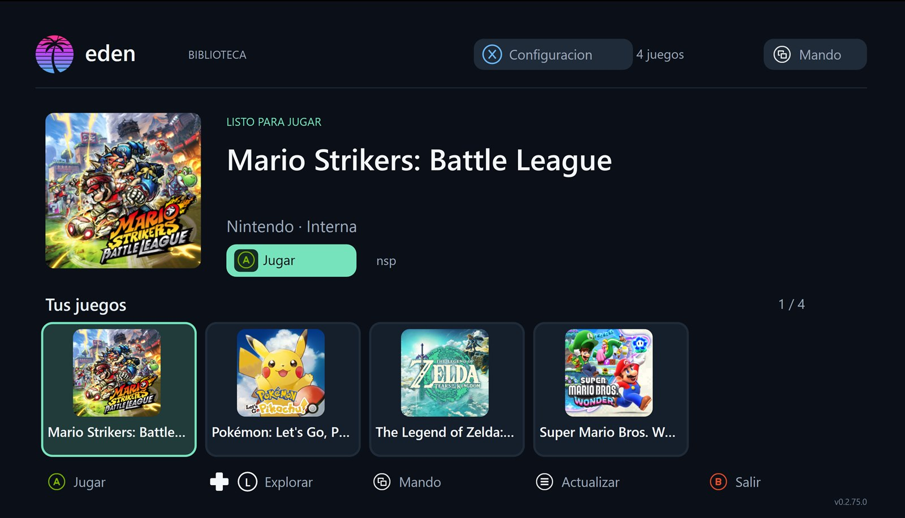

<!--
SPDX-FileCopyrightText: Copyright 2026 Eden Emulator Project and contributors
SPDX-License-Identifier: GPL-3.0-or-later

This README is adapted from the original Eden Xbox UWP README, with changes
and additional documentation for the Xbox One hardware port.
-->

  

<h1 align="center">Eden Xbox One</h1>

  <b>An experimental Nintendo Switch emulator port for the original Xbox One (2013)</b> 
  UWP x64 · Xbox Developer Mode · Native Direct3D 12 · Experimental Shader Model 5.1

  
  
  

> **Early development, not a stable release.** This project targets the **original Xbox One / Xbox One Fat (2013)** in **Developer Mode** with the UWP package classified as a **Game**. Some 2D games now produce images on real hardware; gameplay compatibility is limited. Game content currently appears **upside down** and some titles crash. No title has yet been verified as fully playable from start to finish.

This repository contains the **full emulator source code**, the UWP frontend, the native D3D12 renderer, the Xbox One shader compatibility work, build scripts, diagnostics, and documentation. It is an independent adaptation of the [original Eden Xbox UWP project](https://github.com/JulianDr14/eden-xbox), itself based on [Eden](https://github.com/eden-emulator/mirror). Please retain upstream copyright notices and attribution.

**Contents:** [Progress](#progress) · [Architecture](#architecture) · [Graphics](#graphics-and-shader-translation) · [CPU and memory](#cpu-jit-and-memory-management) · [Frontend](#frontend-and-controls) · [Installation](#installation-on-xbox-one) · [Building](#building-from-source) · [Troubleshooting](#diagnostics-and-known-issues) · [Roadmap](#roadmap) · [Credits](#acknowledgements-and-license).

## Progress

### Hardware and confirmed tests

- **Console:** retail original Xbox One (2013), AMD Jaguar x64 CPU / AMD GCN GPU.
- **Environment:** Xbox Developer Mode, UWP x64, native Direct3D 12.
- **GPU capability observed:** Shader Model **5.1**. The previously used Shader Model 6.4 DXIL game pipelines were rejected by the driver.
- **Breakthrough:** minimal DXBC graphics pipelines passed; the experimental **SPIR-V → HLSL 5.1 → DXBC** path subsequently rendered actual 2D game scenes.
- **Current issue:** the game's rendered output is vertically inverted; the FPS overlay is upright. Rotating the whole app would not be the correct fix.

| Game tested | Observed result on Xbox One Fat | Remaining problems |
| --- | --- | --- |
| **Arcade Archives: CLU CLU LAND** | Displays menus and graphics; approximately **60 FPS** in one reported scene | Guest image upside down; entire game not verified |
| **Sonic Mania** | Displays 2D images and animated scenes; around **17–19 FPS** in test photos | Guest image upside down; performance well below target |
| **A Short Hike** | Starts loading but the emulator closes after roughly **44–46 seconds** in repeated tests | Reproducible memory access violation reading near address 0x78; 3D gameplay not reached |

These are observations from limited hardware tests, **not a compatibility list or a promise of performance**. Different game versions, updates, scenes or future emulator builds may behave differently.

### System status

| Component | Current implementation | Status on original Xbox One |
| --- | --- | --- |
| UWP frontend | Controller-driven library, game management, on-screen menus | Boots and can launch tests |
| D3D12 backend | Custom Direct3D 12 renderer | Generates real 2D game images |
| SM5.1 graphics shaders | SPIRV-Cross translates SPIR-V to HLSL, then D3DCompile generates DXBC | Experimental, incomplete |
| Modern shader backend | Existing Mesa SPIR-V-to-DXIL path retained in source | Not usable for the tested console's SM5.1 game pipeline |
| CPU emulation | Dynarmic ARM64/ARM32 → x64 JIT | Runs tested guest code; prewarm cache supported |
| Audio and input | XAudio2 and gamepad handling | Present; needs per-title testing |
| Textures | Texture cache with CPU/GPU conversion paths | Some compute shaders fail SM5.1 compilation; CPU fallback can be used |
| Performance overlay | FPS, frame timings, emulated CPU and GPU measurements | Appears upright over the game |
| 3D games | Same guest GPU emulation framework, new shader translation route | Not yet confirmed working |
| Crash reports | UWP diagnostics, module offsets, first-chance faults and register/stack capture | Extended for repeatable 3D crash investigation |

## Architecture

Eden emulates the Nintendo Switch operating environment and GPU, while running a native x64 UWP host on Xbox One. The app is a complete emulator port, not a remote-play wrapper, video stream, or compatibility layer for Xbox game executables.

- **UWP frontend:** game library, configuration, game import, input, onscreen keyboard and overlays.
- **Emulation core:** services, filesystem, guest memory, audio, CPU scheduling and Dynarmic JIT.
- **GPU emulation:** Maxwell command processing, shader recompiler, rasterization, texture and buffer caches.
- **D3D12 renderer:** pipelines, descriptor management, swapchain, synchronization, command recording and presentation.
- **Shader backend:** selects a shader translation route from actual device capabilities.

### Graphics and shader translation

The tested original Xbox One reports **Shader Model 5.1**. Its D3D12 driver accepted independently compiled DXBC Shader Model 5.0 test pipelines, while rejecting the emulator's original DXIL game pipelines. This led to the following new **experimental** path:

**Nintendo Switch guest shader** → **Eden SPIR-V** → **SPIRV-Cross** → **HLSL 5.1** → **DXBC** → **D3D12**

Key changes included in this fork:

1. **Shader-model detection** at device initialization, with an alternative compilation route when the reported capability is below 6.0.
2. **SPIRV-Cross HLSL backend** compiled into the UWP emulator, generating Shader Model 5.1 source from the guest SPIR-V representation.
3. **D3DCompile/DXBC creation** for guest shader stages, rather than forcing the console to accept DXIL 6.4.
4. **D3D12 pipeline probes** that test a minimal vertex/pixel graphics state independently of the game's complex shaders.
5. **Detailed shader logs** for conversion, compilation, rejected pipeline states and fallback paths.
6. **Original D3D12 functionality retained** for compatible GPU configurations.

This does **not** mean every shader is supported. Resource register mapping, shader-stage interfaces, runtime constants, texture operations, compute programs, clip-space transformations and some Vulkan-derived semantics still require development and hardware validation.

**The upside-down image is a known regression.** The game is inverted while the frontend statistics overlay is not; the planned correction targets the guest image transformation/presentation rather than rotating the whole UI.

### Inside the renderer

The native D3D12 renderer builds on Eden's existing GPU architecture:

| Area | Source | Responsibility |
| --- | --- | --- |
| Device and scheduling | `src/video_core/renderer_d3d12/d3d12_device*` and `d3d12_scheduler*` | Capability checks, queues, barriers, command lists |
| Graphics pipelines | `d3d12_graphics_pipeline*` and `d3d12_pipeline_cache*` | Guest shader compilation, PSOs, caching and draws |
| Shader compilation | `d3d12_shader_compiler*` | Mesa/DXIL and experimental HLSL/DXBC paths |
| Images and textures | `d3d12_texture_cache*`, `d3d12_astc_gpu_decoder*` | Formats, uploads, ASTC handling, resources |
| Presentation | `d3d12_present_manager*`, `d3d12_present_blit*`, `d3d12_overlay*` | Frame output, swapchain, statistics |
| Diagnostics | `src/video_core/renderer_d3d12/diagnostics/` | Pipeline probes and test instrumentation |

See [graphics and backend documentation](docs/xbox/README.md) and [SM5.1 backend notes](docs/xbox/sm5-game-shader-backend.md). The documentation contains ongoing research; a feature mentioned there may not yet work on actual Xbox One hardware.

### CPU JIT and memory management

Dynarmic translates guest ARM64/ARM32 code into host x64 instructions. UWP enforces executable-memory protection rules, and the emulator maintains a game-specific JIT warm-up mechanism:

- The first launch records which blocks are compiled.
- Subsequent launches may show **CPU JIT loading / compilation progress**, using a previously saved profile to precompile known guest blocks.
- The profile stores hints about what to compile, not an arbitrary executable blob obtained from a game.
- Memory pressure and the console's sandbox limits remain important; the emulator includes cache-management and diagnostic paths.

A CPU JIT progress screen is **not** evidence of a graphics failure. It can appear even when the game eventually draws correctly. Conversely, successful JIT initialization does not prove a title is compatible.

The D3D12 renderer contains memory guards, texture/PSO residency management and other resource controls inherited from the underlying port. Their real effectiveness on the original Xbox One still requires measurements and optimizations.

### Texture formats, audio and input

The renderer handles image transfers and compressed-texture conversion. On this hardware, an **ASTC compute shader may fail to compile in HLSL SM5.1**; the emulator can fall back to CPU decoding, which may affect startup time and frame rate. Some 3D programs still crash before gameplay, and no single cause should be assumed without a crash trace.

Audio is implemented with XAudio2. Physical Xbox controller input is handled through the UWP frontend, with navigation and input configuration in the app. Individual game behavior, rumble and all player slots have not been exhaustively tested on this console.

## Frontend and controls

The original Eden Xbox frontend supplies a controller-friendly game library, artwork handling, configuration screens, import paths, an in-game menu and an optional diagnostics overlay.

  
   
  Frontend illustration from the original UWP project. Xbox One hardware screenshots and compatibility data are reported separately.

Core/frontend code lives under `src/eden_uwp/` and includes game management, controllers, settings, localizations and UWP boot handling. Some options are inherited from upstream and may not be functional for all games on the Xbox One; please report behavior based on actual console tests.

## Localization, themes and experimental graphics settings

The native UWP frontend currently includes **English, Spanish and Brazilian Portuguese
(pt-BR)**. All 469 catalog entries are translated for the Portuguese-Brazil interface.
Interface language and the emulated Nintendo Switch game language are separate choices:
games only display a language if their own files support it.

Go to **Settings → System** to choose:

| Option | Available modes | When applied |
| --- | --- | --- |
| Interface language | Automatic, English, Español, Português (Brasil) | Immediately |
| Game language and region | Auto or supported Switch languages/regions | Restart the **game** |
| Visual theme | Eden, Xbox green, AMOLED black | Immediately |
| Performance statistics | On/Off | Immediately |
| Experimental 3D depth fix | On/Off (committed D3D12 depth textures for SM5.1) | Restart the **game** |
| Clear library cache | Clear covers/titles metadata | Immediately |

The experimental depth fix defaults to **On**, matching the earlier Xbox One
SM5.1 compatibility test. It is an *unverified* workaround for the
*A Short Hike* crash. Turn it Off to compare the previous pooled allocation
method. More dedicated textures can increase memory consumption; this is not
an FPS improvement.

In the in-game image upscaling menu, select **Pixel art · nearest (2D)** for
actual D3D12 point sampling at the final blit instead of bilinear blending.
This preserves sharp edges for pixel art. Bilinear and FSR 1 remain selectable.
This changes image appearance; any FPS increase is **unverified**.

### Two package variants

The [current Xbox One UWP build workflow](https://github.com/kuaan08/one-eden/actions/workflows/xbox-one-uwp.yml)
produces separate installable packages after successful build and signing:

- **Eden-Xbox-OneFat-Gameplay-NoProfiler-APPX:** normal Game package without
  the diagnostic sampling profiler, for performance comparisons.
- **Eden-Xbox-OneFat-SM5-DXBC-Orientation-Fix-APPX:** diagnostic package with
  CPU/GPU sampling and the reproducible 3D-crash instrumentation.

Both use the corrected vertically oriented SM5.1 GPU presentation code.
Because these are different UWP package identities, their LocalState game
configuration and library entries are **separate**. Import your own data as
needed; never distribute keys or game dumps.

**Build success is not hardware validation.** Compare *Sonic Mania* image quality
and FPS in both variants, and only use the diagnostic variant for logs of
*A Short Hike* if it still exits.

## Installation on Xbox One

**Requirements:** an original Xbox One in **Developer Mode**, access to the **Xbox Device Portal**, a signed **x64 APPX** from this project, the signing certificate/dependency packages when required, and your **own legally obtained game files, keys and firmware**.

1. Build or download the relevant **diagnostic APPX** from the [Actions](https://github.com/kuaan08/one-eden/actions) of this repository once a successful package is available. Extract the ZIP.
2. Open the Xbox Device Portal at the console's address, typically `https://<console-ip>:11443`.
3. Install the **APPX** and its **Microsoft.VCLibs.x64.14.00.appx** dependency if requested. Trust the matching signing certificate when required by the console.
4. Set the UWP application classification to **Game** in Developer Mode. Do not use **App** for performance testing.
5. Open Eden, import your own keys/firmware using the frontend, and add game dumps through the library, external storage or the app's LocalState folders.
6. For first tests, try a simple 2D title and collect logs. **Expect inverted game output in the current experimental renderer.**

Do not upload or commit firmware, keys, personal data, copyrighted game files or console credentials to this repository.

## Building from source

**Build environment:** Windows, Visual Studio 2022, compatible Windows SDK, CMake, Windows UWP C++ development components and the auxiliary build tools invoked by the scripts.

Clone the full repository:

    git clone --recurse-submodules https://github.com/kuaan08/one-eden.git
    cd one-eden

Configure and build the UWP x64 executable:

    tools\xbox\build-env.bat cmake --preset uwp-x64
    tools\xbox\build-env.bat cmake --build --preset uwp-x64 --target eden-uwp --parallel 2

The normal Mesa DXIL library is separately built through `tools/xbox/build-spirv-to-dxil.ps1` for environments that use it. The **Xbox One Fat SM5.1 backend**, however, is part of the modified UWP frontend code and also depends on SPIRV-Cross and the HLSL/DXBC compiler.

The packaging script in `tools/xbox/package-appx.ps1` generates the APPX and supporting installation files. The included GitHub Actions workflows can perform Windows UWP compilation and packaging. Inspect the result of the exact workflow run before installing an artifact: not every workflow packages the latest executable.

### Build cache

The current CI setup includes **CPM source download caching**, so repeated builds can reuse downloaded dependency sources. Persistent caching of all C++ object files is **not** yet verified/enabled; first builds can still take a long time. Earlier experiments with C++ compilation cache were not reliable during some dependency builds.

## Diagnostics and known issues

When reporting an Xbox One issue, include the emulator build/commit, title tested, approximate duration before failure, an FPS observation if any, and the logs:

- `eden_uwp_diag.txt` — UWP startup, memory, JIT and crash details.
- `eden/log/eden_log.txt` — emulator/subsystem messages.
- `eden_graphics_bugs.log` — graphics issue deduplication, if produced.
- Additional shader and pipeline artifacts only when necessary and after checking for sensitive files.

The diagnostic build includes support for reporting **first-chance access violations, module offsets, CPU register context and faulting-thread call stacks**. In particular, the repeated *A Short Hike* failure read from address `0x78`; the next diagnostic step is locating its exact module and code path.

**Known issues:**

- **Upside-down guest image** while the statistics overlay remains upright.
- **Low frame rate** in some visually simple games; optimization comes after rendering correctness.
- **Unverified 3D support**, including the current *A Short Hike* close/crash.
- **ASTC fallback** when Shader Model 5.1 compute-shader compilation fails.
- **Unsupported/incorrect shader features** may cause missing textures or PSO failures.
- The project is a **research port**; no general commercial-game compatibility is guaranteed.

## Roadmap

1. Fix the inverted guest image without rotating the correctly oriented UWP overlay.
2. Identify and fix the reproducible 3D access violation using enhanced crash diagnostics.
3. Improve shader-stage linking, resource bindings, texture/compute fallbacks and HLSL compatibility.
4. Validate simple 3D scenes with logs, screenshots and repeatable tests.
5. Reduce draw-call overhead, improve frame pacing and optimize memory usage.
6. Add dependable incremental CI caching and keep signed installable packages available.
7. Broaden compatibility and verify long-term stability before calling individual games playable.

## Documentation

The source contains the original technical notes, plus Xbox One-specific findings:

- [Xbox documentation index](docs/xbox/README.md)
- [Experimental SM5.1/DXBC guest shader backend](docs/xbox/sm5-game-shader-backend.md)
- [D3D12 SM5 graphics pipeline probe](docs/xbox/sm5-dxbc-probe.md)
- [UWP build notes](docs/xbox/uwp_build.md)
- [Console deployment notes](docs/xbox/xbox_deploy.md)
- [Frontend implementation](docs/xbox/xbox_frontend.md)
- [Memory and performance research](docs/xbox/xbox_performance.md)

## Acknowledgements and license

This project is built on substantial work by other developers:

- [Eden](https://github.com/eden-emulator/mirror): original Nintendo Switch emulator core and contributors.
- [JulianDr14/eden-xbox](https://github.com/JulianDr14/eden-xbox): original UWP frontend, Direct3D 12 renderer, extensive optimization and technical documentation. The structure and technical background of this README are adapted from that project.
- [juanresendiz813/eden-xbox](https://github.com/juanresendiz813/eden-xbox): earlier UWP groundwork acknowledged by the original project.
- [Mesa](https://gitlab.freedesktop.org/mesa/mesa): SPIR-V-to-DXIL and shader infrastructure.
- [Khronos SPIRV-Cross](https://github.com/KhronosGroup/SPIRV-Cross): translation to HLSL used by the experimental Xbox One shader backend.
- Contributors to yuzu, Ryujinx, Sudachi, Citron, Torzu, Suyu and related open-source emulation projects.

**Eden Xbox One is an independent community research fork.** It is not affiliated with or endorsed by Nintendo, Microsoft, Eden or any other company named above. Please report issues introduced by this Xbox One-specific port here rather than filing them against upstream projects.

**License:** GNU General Public License v3.0 or later, following the underlying Eden codebase. See [LICENSE.txt](LICENSE.txt) and all third-party licenses/notices in the source. Preserve upstream copyright, authorship and required notices when redistributing modifications.
